<p align="center"><b>TARA</b><br/>Targeted Acquisition and Reach Agent</p>

<p align="center">Turn customer data into targeted growth: explainable product matching, compliant campaigns, and a voice AI agent that calls in Telugu, Hindi or English.</p>

<p align="center">Built for the <picture><source media="(prefers-color-scheme: dark)" srcset="docs/assets/bolna-logo-white.png"></picture> <b>Bolna Voice AI Buildathon</b> (Symphony 2026) by Vivek Goud Adula</p>

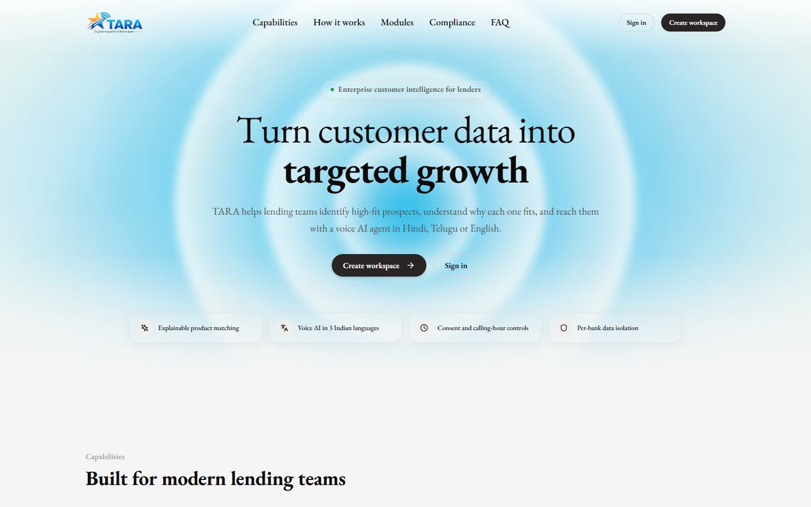

## Links
| | |
|---|---|
| Demo video | [Demo Video (Google Drive)](https://drive.google.com/file/d/1qJCyOLtEc8ge0G4SxX1oy9rWJU2sUitC/view?usp=drive_link) |
| Pitch deck | [Pitch Deck (Canva)](https://canva.link/v2xhqg6o7zwfm2i) |
| X / social post | [X / Social Post](https://x.com/VivekGoudAdula/status/2116190642263273747) |
| Live app | [https://tara-bolna.vercel.app/](https://tara-bolna.vercel.app/) |

## The problem
Banks and lenders hold millions of customers and leads, but outreach is manual, channels are fragmented, and compliance is left to individual scripts. Teams call everyone, so contact quality is low. The challenge is not having customers; it is activating the right ones, for the right product, in their own language.

## What TARA does
1. **Import** customers or leads from CSV (validated, deduplicated, consent-aware) or load sample data.
2. **Score and match**: every customer and lead is scored against every product, with reason codes and policy eligibility checks. One lead can match many products. Lower scores are never deleted.
3. **Build a campaign**: choose a product, filter the audience by High / Medium / Low fit, score range and eligibility, and see who would be blocked by compliance before anything is dialled.
4. **Configure the voice agent**: prompt addendum, opening line, questions to collect, success condition, fallback and retry policy are stored as versioned configuration, not hard-coded.
5. **Launch through a communication API**: the campaign never talks to a telephony provider. It calls a reusable communication service, which calls Bolna.
6. **Capture outcomes**: status timeline, transcript and structured fields land in Interaction History.

## Why Bolna &nbsp;<picture><source media="(prefers-color-scheme: dark)" srcset="docs/assets/bolna-logo-white.png"></picture>

TARA decides who to call, for which product, and what to say. Bolna is the voice engine that makes the call. We chose Bolna because it let us spend the build time on the lending workflow instead of audio plumbing.

| What we needed | What Bolna gave us &nbsp;<picture><source media="(prefers-color-scheme: dark)" srcset="docs/assets/bolna-logo-white.png"></picture> | How TARA uses it |
|---|---|---|
| Indian languages on a real phone call | Hindi and Telugu with mid-call language switching, plus Sarvam speech models that can be connected on your own account | The agent opens in a customer's stored language and followed the caller from Hindi into Telugu in a real test call |
| One agent, many campaigns | Per-call dynamic variables (`user_data`) that fill the agent prompt and welcome message | One Bolna agent serves every campaign. Each campaign's objective, questions, tone and opening line are sent as variables, so prompts are configuration, not code |
| Bring your own stack | Telephony, speech and LLM providers connected with your own keys (we used Twilio, Sarvam and an LLM via Groq) | We could pick models for Indic languages and swap them without touching TARA code |
| Results back into our product | Call webhooks with status events and transcripts, plus configurable extractions | The webhook feeds TARA's status timeline and transcript; extractions populate interest, amount and callback time when configured |
| Guardrails for outbound calling | Call timeouts, silence hang-up and calling guardrails | These sit under TARA's own checks (consent, DND flag, calling hours, frequency cap), which run before any call is dispatched |
| Speed to a working demo | A hosted agent studio and a simple REST call (`POST /call`) | A working voice loop in the first day, which left the rest of the time for scoring, campaigns and governance |
| A path past the demo | Bulk calling, batches, retries, workflows and India data-residency options in their docs | Not used in this build. These are the route to scale in a pilot |

### Why not build the voice stack ourselves
Real-time speech-to-text, LLM reasoning, speech synthesis, telephony, interruption handling and latency tuning are a product on their own. Building them in a few days would have meant a worse voice agent and no time for the lending workflow. TARA's value is the intelligence before the call and the controls around it.

### How the decoupling works
Campaign code never imports Bolna. It calls TARA's communication API, which calls a provider adapter. Bolna-specific field names live in two files only: `backend/app/providers/bolna_voice.py` and `backend/app/providers/bolna_webhook_mapper.py`. Replacing or adding a voice provider means writing another adapter, not changing campaigns.

### Honest limits
- We used Bolna on a trial plan with verified numbers only, so results are from test calls, not production traffic.
- Latency and cost per call are visible in Bolna's dashboard but are not part of its webhook payload, so TARA's dashboard shows them as unavailable.
- Structured extraction depends on the Extractions configured in the Bolna agent.
- We have not benchmarked Bolna against other voice platforms, and we make no claim that it is better than them. It was the best fit for Indian languages, fast setup and our own-keys architecture.

## Screenshots
| | |
|---|---|
| 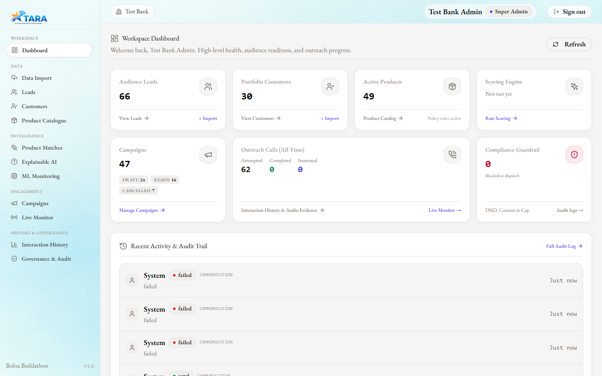 **Dashboard** with a getting-started checklist driven by real state | 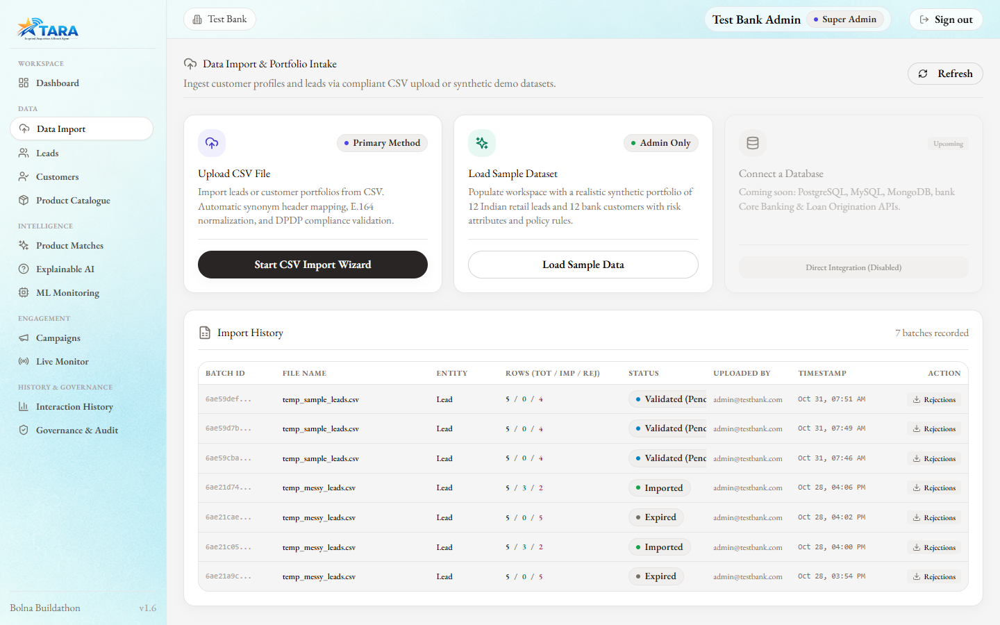 **Data import**: CSV, sample data, database connectors (roadmap) |
| 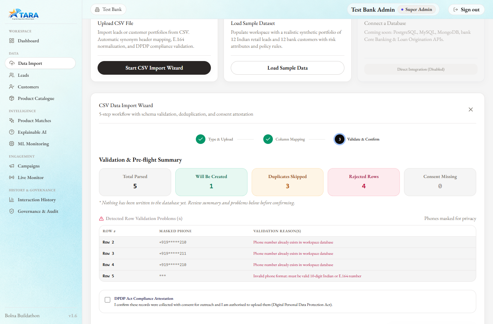 **Validation preview**: rejects, duplicates, consent flags; nothing is written until confirmed | 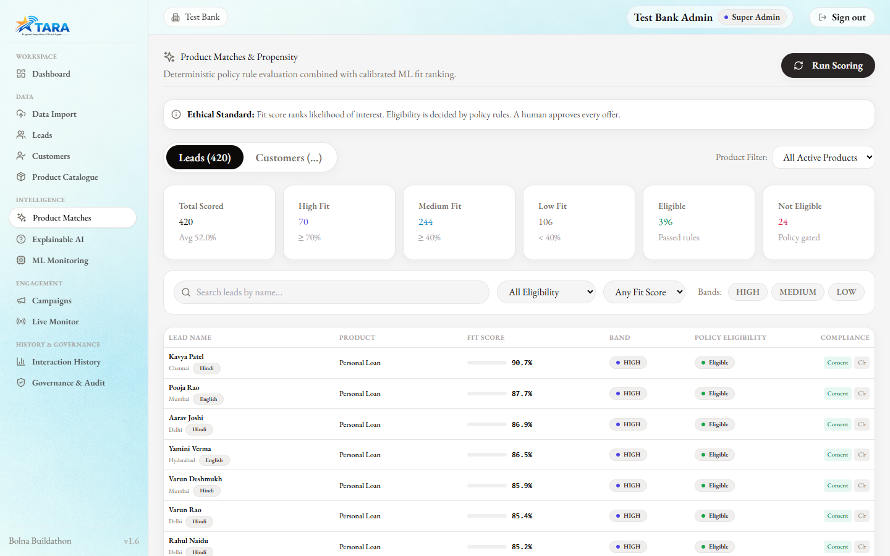 **Product matches** across all products |
| 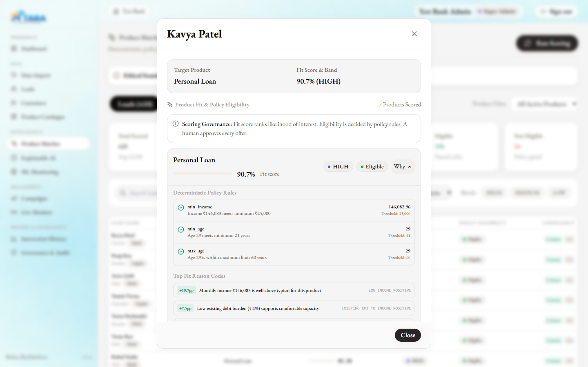 **Why panel**: reasons and eligibility checks for each match | 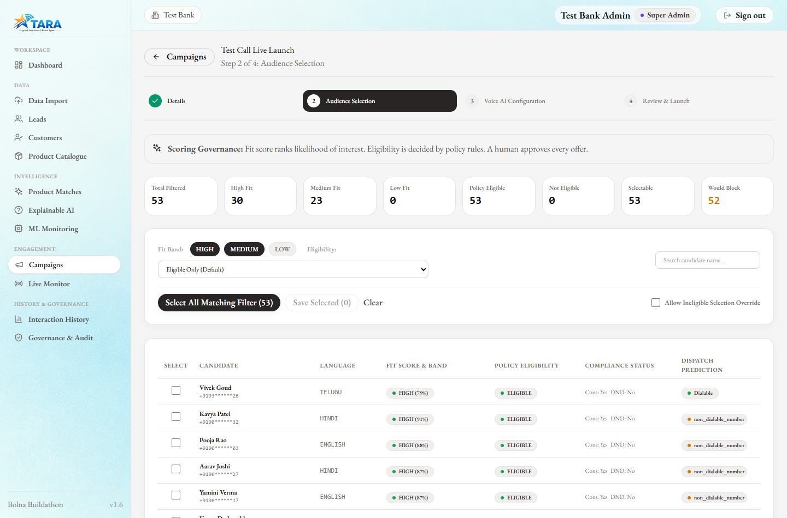 **Audience builder**: band, score, eligibility; compliance preview |
| 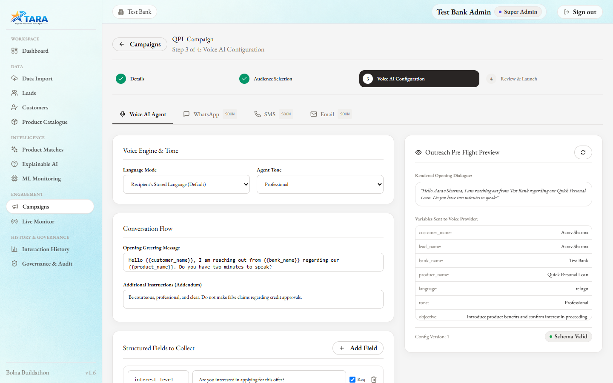 **Voice configuration** with live preview | 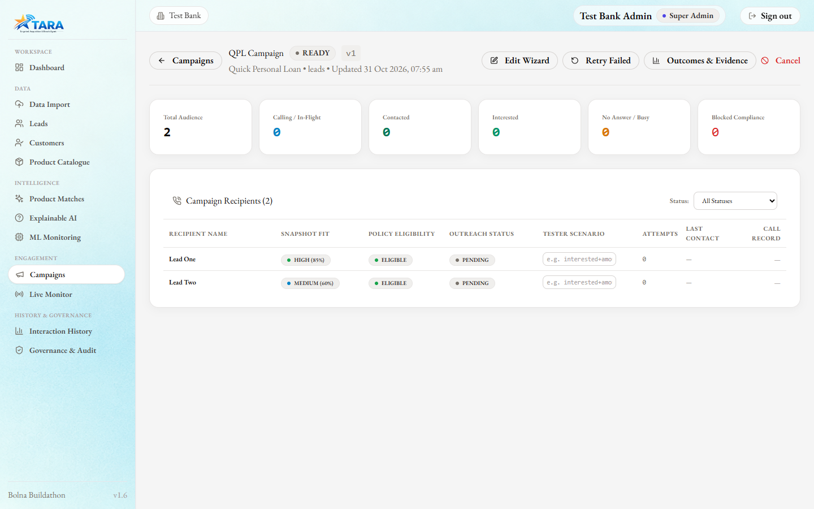 **Campaign detail**: live recipient status |
| 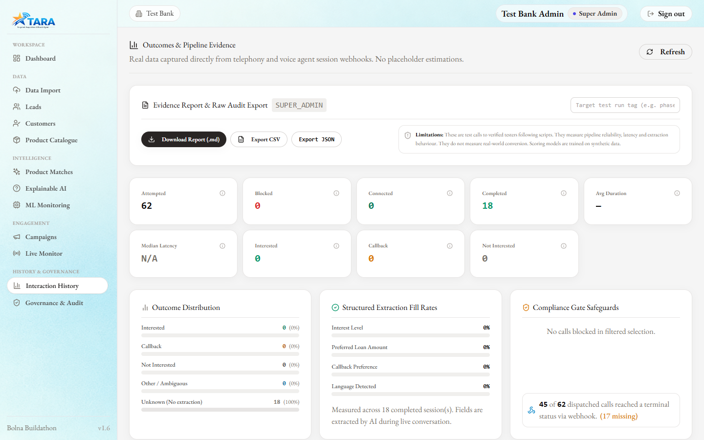 **Interaction history** | 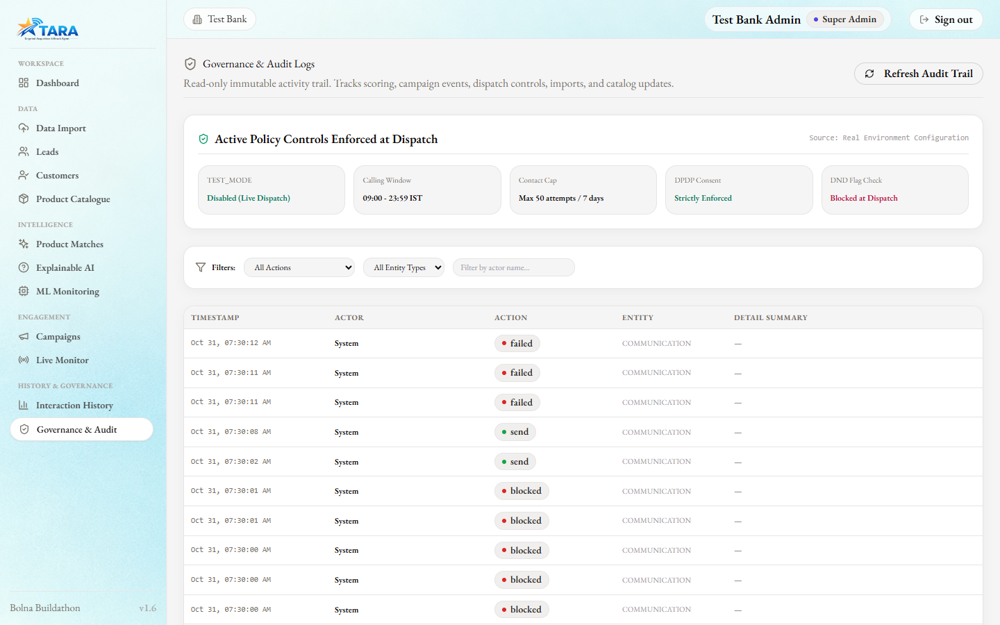 **Governance and audit** |

## Live call (real test call)
A campaign launched from the app placed a real call through Bolna to the author's own verified number. The agent opened in Hindi, then switched to Telugu when the caller replied in Telugu, answered a question about the loan, and recorded the requested amount.

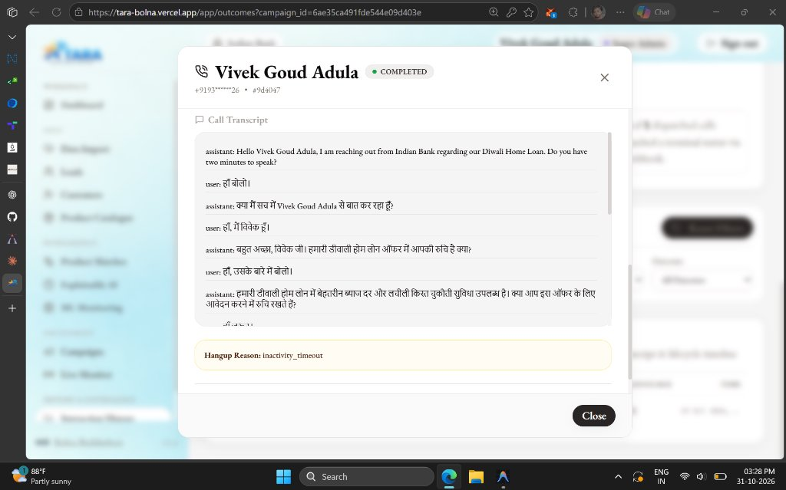
*(screenshot pending)*

<details><summary>Transcript (test call, "Dummy Bank", phone number masked; English glosses added)</summary>

```
assistant: Hello Vivek Goud, I am reaching out from Dummy Bank regarding our Festive Loan. Do you have two minutes to speak?
user: हेलो।
assistant: नमस्ते, क्या मैं वीवेक गौड़ से बात कर रहा हूँ?   (Hello, am I speaking with Vivek Goud?)
user: हाँ बोलो।
assistant: Dummy Bank की ओर से हमारी Festive Loan की जानकारी देना चाहता हूँ। क्या आप इस ऑफर के बारे में जानना चाहेंगे?
user: ఆ చెప్పండి.   (Yes, go ahead.)
assistant: మీకు అవసరమైనప్పుడు సులభంగా రుణం పొందవచ్చు. ఈ ఫెస్టివ్ లోన్లో తక్కువ వడ్డీ రేటు మరియు సులభమైన తిరిగి చెల్లింపు ఎంపికలు ఉన్నాయి.
user: ఎంత లోన్ ఇస్తారు?   (How much loan do you give?)
assistant: మీ అవసరాలకు అనుగుణంగా రుణ మొత్తం నిర్ణయించబడుతుంది. మీకు ఎంత మొత్తం అవసరం?   (The amount depends on your needs. How much do you need?)
user: ఐ నీడ్ లోన్ వర్క్. ₹1,00,000
assistant: మీరు ₹1,00,000 రుణం కోరుకుంటున్నారని నమోదు చేశాను. ఈ ఆఫర్కు అప్లై చేయడానికి మీకు ఆసక్తి ఉందా?   (I have noted you want Rs 1,00,000. Are you interested in applying?)
user: ఆ.
assistant: మీరు అప్లై చేయడానికి ఆసక్తి చూపినందుకు ధన్యవాదాలు.   (Thank you for your interest in applying.)
```
</details>

This was a scripted test to a verified tester, not a customer conversion.

## Architecture
```
CSV import -> Scoring + product matching -> Campaign builder -> Voice configuration
          -> Communication API -> Provider adapter (Bolna voice) -> Phone
Bolna webhook -> TARA webhook endpoint -> status, transcript, outcome -> Interaction History
```
- **Campaign is independent of providers.** It calls the communication service in-process; the communication module never imports campaign code (enforced by a test).
- **Provider adapters** isolate Bolna field names. WhatsApp, SMS and Email adapters exist as stubs.
- **Multi-tenant isolation:** tenant_id comes only from the JWT; cross-tenant access returns 404.
- **Compliance gate at dispatch:** TEST_MODE allowlist, consent required, DND flag, calling-hour window (default 09:00 to 21:00 IST), contact-frequency cap, duplicate in-flight check. Blocked attempts are stored with the reason.
- **Audit log** of sends, blocks, webhooks, imports, scoring runs, exports and campaign actions.

### Scoring and explainability
- Eligibility is deterministic policy rules from the product catalogue, shown check by check. Propensity is a logistic-regression fit score. The model ranks fit and never decides eligibility or credit; a human approves every offer.
- Explanations are exact: contributions come from the model's own coefficients, with template-based reason text. No LLM generates reasons.
- Models run at inference from committed JSON artifacts in pure Python.
- Language, city, age, gender and name are excluded from model features; age is used only as an eligibility rule.
- **The models are trained on synthetic data.** Metrics demonstrate the pipeline, not real-world performance. A pilot would retrain on the lender's own conversion history.

### What data reaches the voice stack
The voice provider receives only what the call needs: first name, bank name, product name, language, tone and the configured prompt text. Income, scores, bands, eligibility and reason codes are not sent (enforced by a test). Call audio and transcripts are processed by Bolna and its configured speech, LLM and telephony providers; review their terms before any production use.

## Tech stack
FastAPI, Python, MongoDB (Atlas), React + Vite + Tailwind, JWT auth. Voice: Bolna agent with Twilio telephony, Sarvam speech, and an LLM via Groq (configured in the Bolna dashboard).

## Quick start
Prerequisites: Python 3.11+, Node 18+, a MongoDB URI, a Bolna account (only needed for real calls).
```bash
# backend
cd backend
pip install -r requirements.txt
cp .env.example .env        # fill in values; never commit .env
python scripts/seed.py
python -m uvicorn app.main:app --reload --port 8000

# frontend
cd frontend
npm install
cp .env.example .env
npm run dev                 # http://localhost:5173
```
Run tests (uses a separate test database): `cd backend && python -m pytest`

### Environment variables (names only; see backend/.env.example)
MONGO_URI, MONGO_DB_NAME, MONGO_DB_NAME_TEST, SECRET_KEY, SEED_PASSWORD, BOLNA_API_KEY, BOLNA_AGENT_ID, BOLNA_FROM_NUMBER, BOLNA_WEBHOOK_SECRET, TEST_MODE, TEST_ALLOWLIST, CALL_WINDOW_START, CALL_WINDOW_END, CONTACT_CAP_COUNT, CONTACT_CAP_DAYS, PUBLIC_BASE_URL, CAMPAIGN_MAX_RECIPIENTS, CAMPAIGN_MAX_CONCURRENT, CAMPAIGN_DISPATCH_DELAY_SECONDS.

### Bolna &nbsp;<picture><source media="(prefers-color-scheme: dark)" srcset="docs/assets/bolna-logo-white.png"></picture> agent setup (required for campaign calls)
1. Create a Bolna agent (cascaded engine, Twilio telephony, Sarvam voice and transcription, an LLM of your choice).
2. Set the welcome message to `{{opening_message}}`.
3. In the Conversation Flow include these variables: `{{objective}}`, `{{system_prompt_addendum}}`, `{{conversation_steps}}`, `{{tone}}`, `{{questions_to_collect}}`, `{{success_condition}}`, `{{fallback_behaviour}}`.
4. In the Extractions tab add `interest_level`, `preferred_amount`, `preferred_callback_time`, `language_used`.
5. Set the webhook URL to `<PUBLIC_BASE_URL>/api/webhooks/bolna` with header `X-Webhook-Secret` equal to BOLNA_WEBHOOK_SECRET. Use a tunnel (ngrok or cloudflared) for local development.

### Safe testing
TEST_MODE=true by default: only numbers in TEST_ALLOWLIST can be called. Seeded and sample numbers are fake and non-dialable. Trial telephony accounts can only call verified numbers.

### Developer scripts
- `backend/scripts/dev/dry_demonstration.py`: End-to-end campaign creation and mocked dispatch demonstration through the API.
- `backend/scripts/dev/sync_tenants.py`: Developer utility to sync tenants with test numbers and refreshed scores.
- `backend/scripts/dev/upsert_test_user.py`: Developer utility to upsert a verified test recipient into a target tenant workspace.

## What is built vs roadmap
| Built | Roadmap |
|---|---|
| CSV import with validation, dedupe, consent attestation | Database connectors |
| Explainable product matching (synthetic-data models) | Retraining on a lender's real outcomes; feedback loop into scoring |
| Campaign builder, voice configuration, preview, launch, pause/resume | Automatic scheduled retries |
| Voice calls via Bolna (Hindi, Telugu, English) | WhatsApp, SMS, Email execution (config UI and stubs only) |
| Consent, DND flag, calling-hour window, frequency cap, audit log | National DND/NDNC registry integration |
| Tenant isolation, role-based access | Fine-grained permission editor |
| Outcomes dashboard: status timeline, transcript | See Known limitations |

## Known limitations
- Structured extraction fields (interest level, amount, callback time) depend on Bolna Extractions configuration and are not yet populated reliably; the transcript and status timeline are.
- Call latency and cost are not provided in Bolna's webhook payload, so the dashboard shows them as unavailable.
- Test calls were made to verified testers and measure pipeline behaviour, not real-world conversion.
- Compliance controls are policy checks on the platform's own records. They do not include the national DND registry and are not a regulatory certification.

## Evidence
EVIDENCE_PLACEHOLDER (to be filled only from the real evidence report: number of test calls, number of testers, scenarios)

## Author
Vivek Goud Adula  
- **Contact**: [adulavivekgoud@gmail.com](mailto:adulavivekgoud@gmail.com)  
- **LinkedIn**: [https://www.linkedin.com/in/vivekgoudadula/](https://www.linkedin.com/in/vivekgoudadula/)